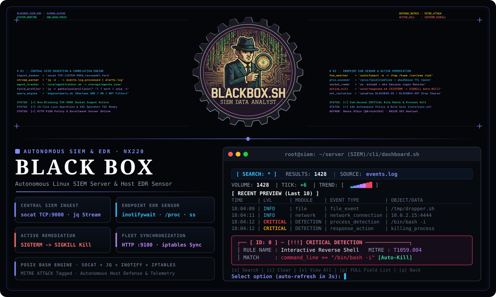
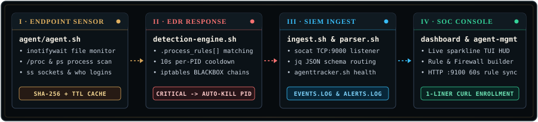
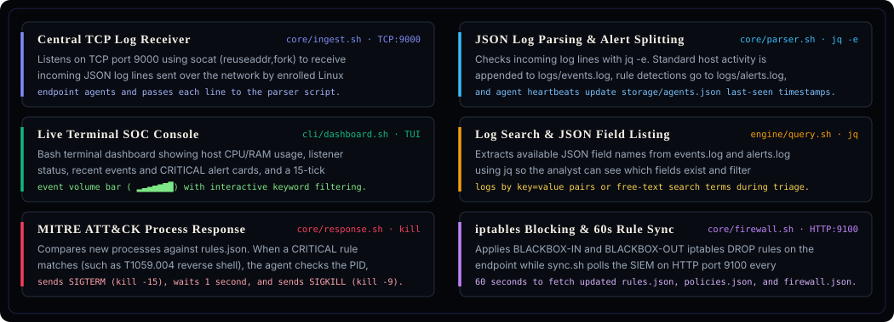
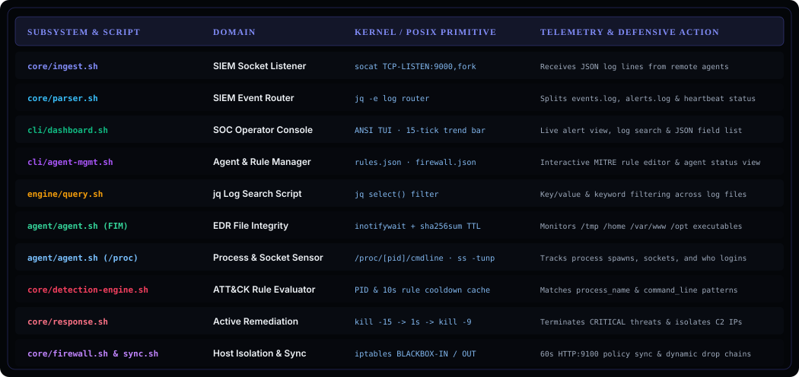
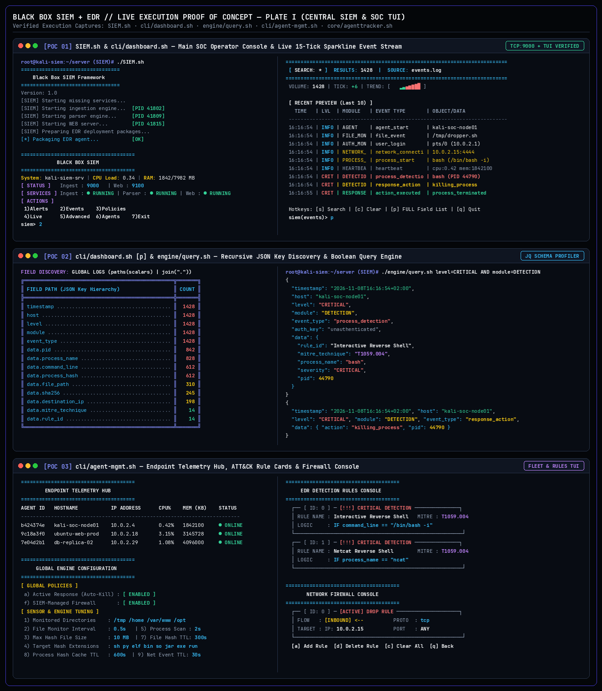
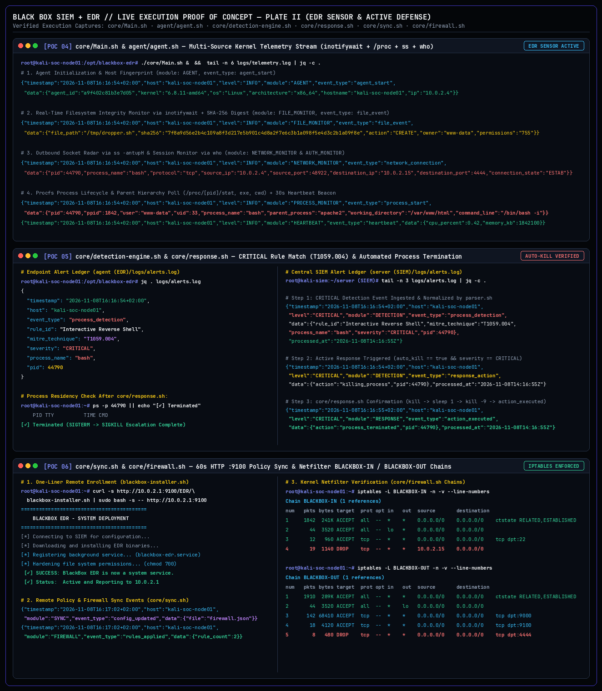
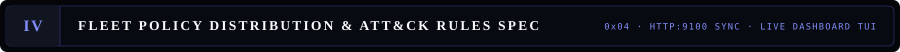
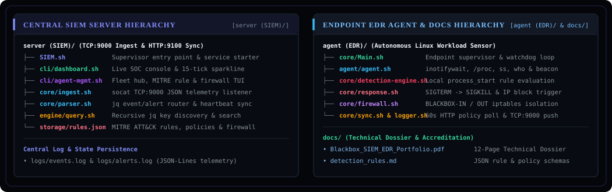

<div align="center">



<br/>

[](server%20%28SIEM%29/SIEM.sh)
[](server%20%28SIEM%29/core/ingest.sh)
[](agent%20%28EDR%29/agent/agent.sh)
[](docs/detection_rules.md)
[-56d364?style=for-the-badge&logo=readthedocs&logoColor=white&labelColor=06090e)](docs/Blackbox_SIEM_EDR_Portfolio.pdf)
[](docs/NX220_SOC_Analyst_Accreditation.pdf)

</div>

<p align="center">
  
</p>

<p align="center">
  
  
</p>

<p align="center">
  
  
</p>

<p align="center">
  
  <a href="docs/Blackbox_SIEM_EDR_Portfolio.pdf" title="Open Black Box Technical Portfolio Dossier (12-Page PDF)"></a>
  <a href="docs/Blackbox_SIEM_EDR_Portfolio.pdf" title="Open Black Box Technical Portfolio Dossier (12-Page PDF)"></a>
</p>

<p align="center">
  
</p>

```bash
# 1. Launch Central SIEM Server (TCP:9000 Ingest, Parser, HTTP:9100 Sync & Live SOC TUI)
git clone https://github.com/ArtistS24/blackbox-siem-edr.git
cd "blackbox-siem-edr/server (SIEM)"
chmod +x SIEM.sh cli/*.sh core/*.sh engine/*.sh
sudo ./SIEM.sh

# 2. Enroll or Launch Linux Endpoint EDR Agent
cd "../agent (EDR)"
chmod +x core/*.sh agent/*.sh
sudo ./core/Main.sh
```

<p align="center">
  
</p>

<div align="center">

[](http://www.dest-unreach.org/socat/)
[](https://github.com/jqlang/jq)
[](https://github.com/inotify-tools/inotify-tools)
[](https://attack.mitre.org/)
[](https://www.netfilter.org/)

</div>
