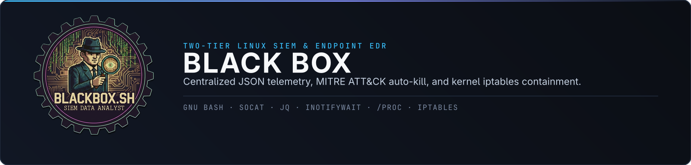
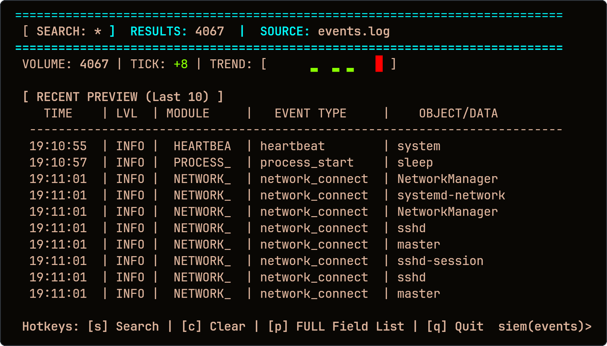
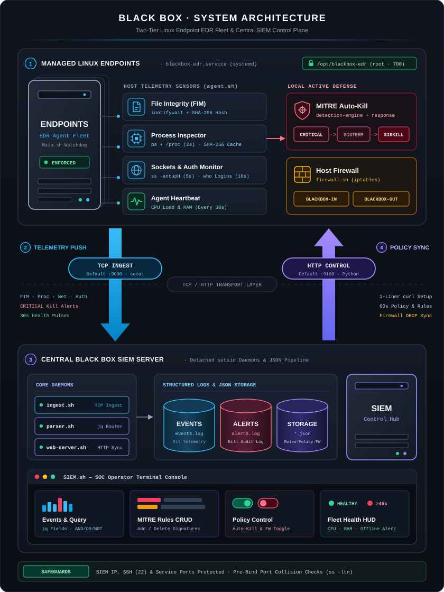
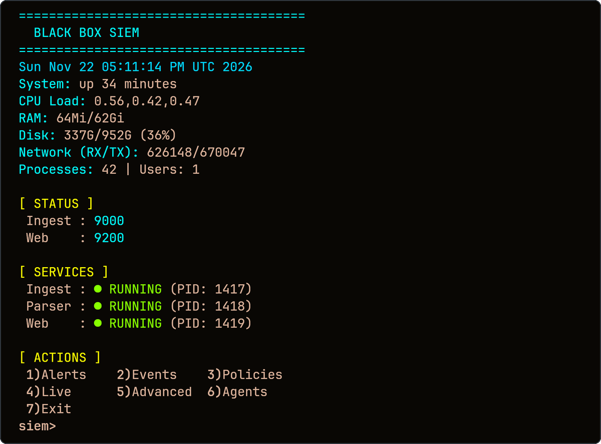
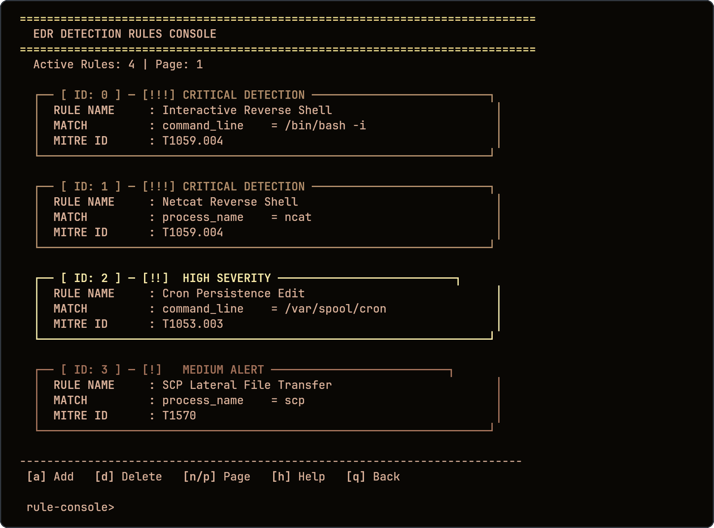
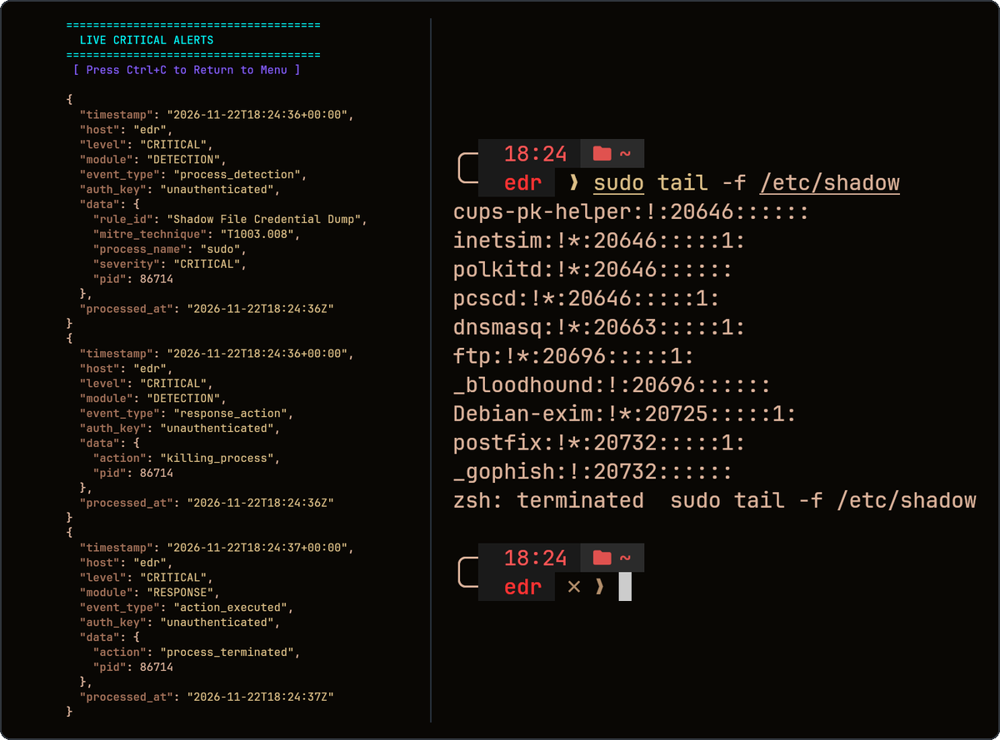
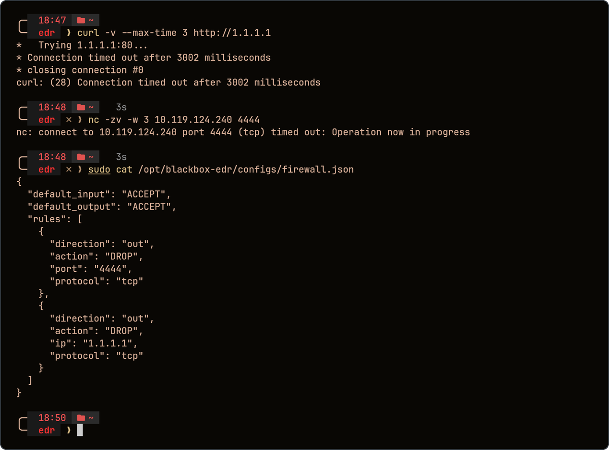

<div align="center">



<br/>

<p>
  <a href="docs/Blackbox_SIEM_EDR_Portfolio.pdf"></a>
  <a href="docs/detection_rules.md"></a>
  <a href="#quick-start"></a>
  <a href="LICENSE"></a>
</p>

<p>
  <a href="#architecture">Architecture</a> ·
  <a href="#features">Features</a> ·
  <a href="#live-proof-of-concept">Live PoC</a> ·
  <a href="#quick-start">Quick Start</a> ·
  <a href="#documentation">Documentation</a>
</p>

<br/>

<a href="docs/Blackbox_SIEM_EDR_Portfolio.pdf">
  
</a>

</div>

<br/>

**Black Box** pairs a centralized Linux SIEM server with a hardened Endpoint Detection and Response (EDR) agent built directly on standard Linux primitives (`inotifywait`, `/proc`, `ss`, `who`, `socat`, `jq`, and `iptables`). Endpoints stream structured JSON telemetry over TCP, evaluate MITRE ATT&CK behavioral rules locally, and pull policy, rule, and firewall updates over HTTP every 60 seconds.

## Architecture

Enrolled endpoints forward telemetry over TCP (`:9000` default) and synchronize policies, MITRE rules, and `iptables` rules from the SIEM HTTP service (`:9100` default):

<p align="center">
  <a href="assets/architecture.svg">
    
  </a>
</p>

## Features

- **Real-Time Endpoint Telemetry** — File integrity monitoring (`inotifywait` + SHA-256), 2s `ps`/`/proc` process inspection, 5s `ss -antupH` socket tracking, and 10s `who` session monitoring.
- **Local MITRE ATT&CK Detection & Auto-Kill** — Evaluates `process_start` events against `rules.json` with per-PID deduplication and 10s cooldown; terminates `CRITICAL` threats via `SIGTERM -> 1s -> SIGKILL` or runs detect-only.
- **Kernel-Level Containment** — Enforces synced `BLACKBOX-IN` and `BLACKBOX-OUT` `iptables` DROP chains with anti-lockout guards protecting the SIEM IP, `127.0.0.1`, SSH (`22`), and active service ports.
- **Interactive SOC Console** — Real-time host HUD, 15-tick event volume sparkline, live critical alert stream, recursive `jq` field discovery, and `AND`/`OR`/`NOT` log search.
- **Fleet Lifecycle & Hardening** — One-line `curl` enrollment, `HEALTHY` vs. `OFFLINE (>45s)` heartbeat tracking, `root:root` + `chmod 700` tamper protection, and a 5s `Main.sh` watchdog under `systemd`.

## Live Proof of Concept

Captured live across an isolated two-node Linux deployment (`siem` control server and enrolled `edr` endpoint):

<table>
  <tr>
    <td width="50%" align="center">
      <a href="assets/screenshots/siem-console.png"></a><br/>
      <sub><b>SIEM Operations Console</b> — Host HUD &amp; live daemons</sub>
    </td>
    <td width="50%" align="center">
      <a href="assets/screenshots/edr-mitre-rules.png"></a><br/>
      <sub><b>MITRE Rules Console</b> — Live interactive rule CRUD</sub>
    </td>
  </tr>
  <tr>
    <td width="50%" align="center">
      <a href="assets/screenshots/edr-autokill.png"></a><br/>
      <sub><b>Auto-Kill Proof (<code>T1003.008</code>)</b> — 3-stage SIEM audit &amp; process kill</sub>
    </td>
    <td width="50%" align="center">
      <a href="assets/screenshots/edr-iptables-drop.png"></a><br/>
      <sub><b><code>iptables</code> Containment</b> — Synced <code>BLACKBOX-OUT</code> DROP rules</sub>
    </td>
  </tr>
</table>

<p align="center">
  <sub>Full 10-stage operational walkthrough (62 live captures) in the <a href="docs/Blackbox_SIEM_EDR_Portfolio.pdf"><strong>18-Page Technical Architecture &amp; PoC PDF</strong></a>.</sub>
</p>

## Quick Start

Requires Linux with `root` privileges. Both `SIEM.sh` and the remote endpoint installer automatically check and install missing dependencies (`socat`, `jq`, `openssl`, `python3`, `inotify-tools`, `iptables`, `iproute2`, `curl`) via `apt`, `dnf`, `yum`, or `pacman`.

**1. Launch the Central SIEM server** (first run opens the setup wizard and starts detached daemons):

```bash
git clone https://github.com/ArtistS24/blackbox-siem-edr.git
cd "blackbox-siem-edr/server (SIEM)"
sudo ./SIEM.sh
```

**2. Enroll remote Linux endpoints** (copy the exact 1-liner from `6) Agents -> 2) Enroll New Endpoint`):

```bash
curl -s http://<SIEM_IP>:<WEB_PORT>/EDR/blackbox-installer.sh | sudo bash -s -- http://<SIEM_IP>:<WEB_PORT>
```

<details>
<summary>Shutdown &amp; endpoint removal commands</summary>

```bash
# Stop SIEM background daemons
sudo ./core/stopservice.sh

# Remove endpoint systemd service, iptables chains, and /opt/blackbox-edr
sudo /opt/blackbox-edr/core/blackbox-uninstaller.sh
```

</details>

<details>
<summary>Default MITRE ATT&amp;CK detection rules (<code>storage/rules.json</code>)</summary>

| Rule | Match Field | Pattern | MITRE ATT&CK | Severity |
| :--- | :--- | :--- | :--- | :--- |
| Interactive Reverse Shell | `command_line` | `/bin/bash -i` | `T1059.004` | `CRITICAL` |
| Netcat Reverse Shell | `process_name` | `ncat` | `T1059.004` | `CRITICAL` |
| Cron Persistence Edit | `command_line` | `/var/spool/cron` | `T1053.003` | `HIGH` |
| SCP Lateral File Transfer | `process_name` | `scp` | `T1570` | `MEDIUM` |

</details>

<details>
<summary>Repository layout</summary>

```text
blackbox-siem-edr/
├── server (SIEM)/
│   ├── SIEM.sh            # Setup wizard & detached service launcher
│   ├── cli/               # SOC dashboard & agent/rule/firewall consoles
│   ├── core/              # socat TCP ingest, jq parser, heartbeat tracker & HTTP sync
│   ├── engine/            # Recursive jq field discovery & AND/OR/NOT query engine
│   └── storage/           # rules.json, policies.json, firewall.json & agent tarball
├── agent (EDR)/
│   ├── agent/             # FIM (inotifywait/SHA-256), /proc, ss, who & heartbeat loops
│   ├── core/              # Main.sh watchdog, detection engine, auto-kill, iptables & sync
│   └── config/            # Endpoint runtime configuration
├── docs/                  # 18-Page Technical PoC PDF & JSON detection/policy schemas
└── assets/                # Architecture vector diagram & real terminal captures
```

</details>

## Documentation

| Document | Contents |
| :--- | :--- |
| [Technical Architecture & Live PoC (PDF)](docs/Blackbox_SIEM_EDR_Portfolio.pdf) | 18-page engineering walkthrough: setup, enrollment, tamper hardening, detection, auto-kill, firewall & `jq` triage |
| [Detection Rules & Policy Reference](docs/detection_rules.md) | Complete JSON schemas for `rules.json`, `policies.json`, and `firewall.json` |

<br/>

<p align="center">
  <sub>MIT License · Built by <a href="https://github.com/ArtistS24">Denis Albin</a></sub>
</p>
