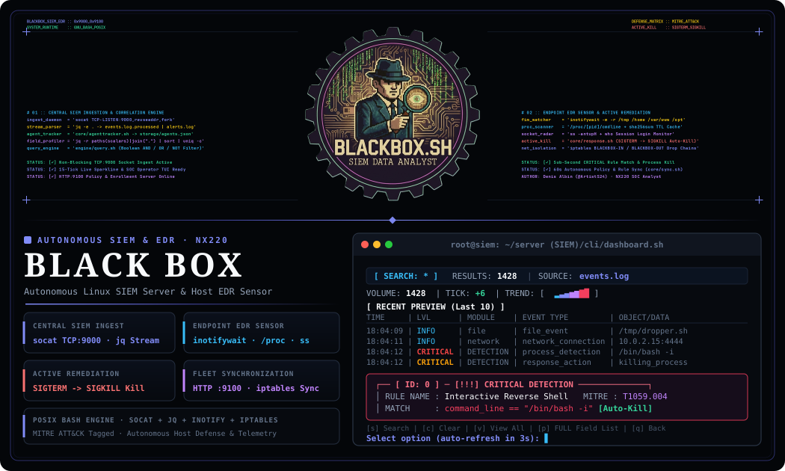
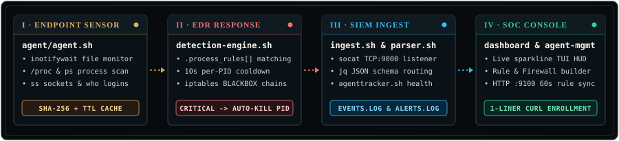
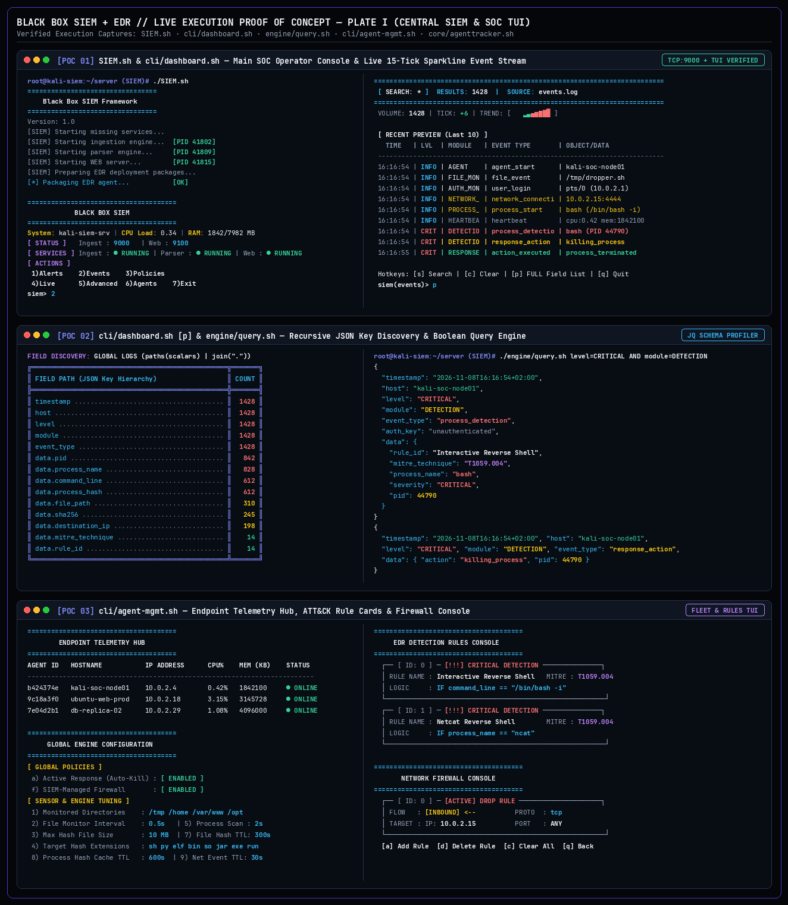
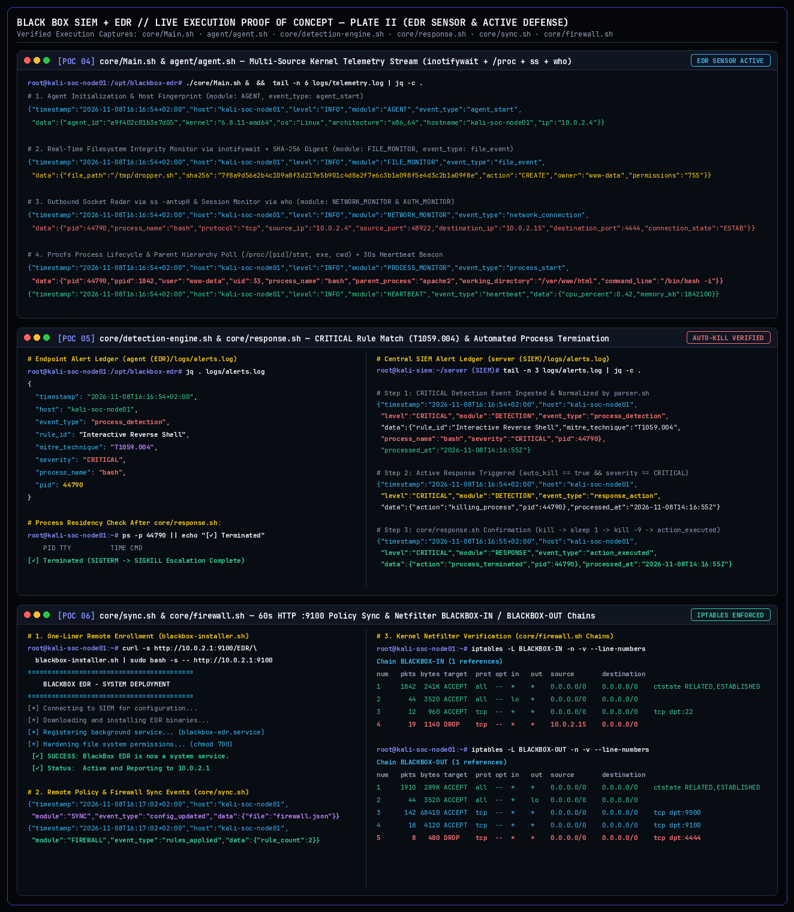

<div align="center">



<br/>

[](server%20%28SIEM%29/SIEM.sh)
[](server%20%28SIEM%29/core/ingest.sh)
[](agent%20%28EDR%29/agent/agent.sh)
[](docs/detection_rules.md)
[-56d364?style=for-the-badge&logo=readthedocs&logoColor=white&labelColor=06090e)](docs/Blackbox_SIEM_EDR_Portfolio.pdf)
[](docs/NX220_SOC_Analyst_Accreditation.pdf)

</div>

<br/>

**Black Box** is a two-part Linux security monitoring and active defense framework engineered from scratch in pure POSIX-compliant GNU Bash: a central **SIEM Server** that ingests JSON telemetry over raw TCP sockets, tracks endpoint heartbeats, and provides an interactive terminal SOC console with live sparkline volume tracking, paired with an **EDR Agent** that runs autonomously on Linux workloads to monitor files, processes, network sockets, and user sessions in real time.

The project originated during the **SOC Analyst (`NX220` — SIEM)** module in the **Magen Cyber** track at **John Bryce (ThinkCyber / Cyberium)** and evolved into a production-grade defensive platform featuring remote policy distribution, MITRE ATT&CK-mapped detection rules, automated `SIGTERM`/`SIGKILL` remediation, and dynamic `iptables` host isolation.

> [!IMPORTANT]
> **Complete Technical Portfolio & Proof-of-Concept Dossier**: Detailed system architecture, data schemas, MITRE ATT&CK coverage, and step-by-step threat remediation walkthroughs are published in the official 8-page companion dossier: [**`docs/Blackbox_SIEM_EDR_Portfolio.pdf`**](docs/Blackbox_SIEM_EDR_Portfolio.pdf).

<br/>


<br/>

<div align="center">
  
</div>

<br/>

- **Non-Blocking TCP Socket Ingest (`core/ingest.sh`)** — Listens on `TCP:9000` using `socat` (`reuseaddr,fork`), streaming raw JSON lines into memory without thread exhaustion or lock contention during high-velocity event bursts.
- **JSON Schema Validation & Routing (`core/parser.sh`)** — Pipes incoming telemetry directly through `jq -e` validation. Normal events route to `logs/events.log`; rule triggers concurrently push to `logs/alerts.log`; heartbeat beacons update `storage/agents.json`.
- **Live Terminal SOC Dashboard (`cli/dashboard.sh`)** — ANSI operator console displaying CPU/RAM host metrics, service daemon health, live event preview table, and an animated 15-tick volume trend sparkline (` ▂▃▄▅▆▇█`).
- **Multi-Field JSON Key Discovery (`engine/query.sh`)** — Recursive field profiler (`paths(scalars) | join(".")`) revealing JSON key cardinality across millions of logs in seconds.

<br/>


<br/>

- **Filesystem Integrity Monitoring (`agent/agent.sh`)** — Watches `/tmp`, `/home`, `/var/www`, and `/opt` via kernel `inotifywait` (`modify,create,delete,move`), computing SHA-256 hashes on newly created executables (`sh`, `py`, `bin`, `elf`, `so`) with TTL caching to eliminate redundant I/O.
- **Process Lifecycle Interceptor** — Sweeps `/proc` and process tree hierarchy for unauthorized binaries, command lines, and parent-child relationships (e.g. web servers spawning interactive shells).
- **Network Socket Probing** — Executes rapid `ss -tunp` socket polls to detect foreign C2 connections and reverse shell established states before exfiltration commences.
- **Heartbeat & Telemetry Serialization (`core/logger.sh`)** — Packages system telemetry, logged-in sessions via `who`, load averages, and health beacons into uniform JSON structures dispatched over `socat TCP:9000`.

<br/>


<br/>

<div align="center">
  <a href="docs/Blackbox_SIEM_EDR_Portfolio.pdf" title="Open Black Box Technical Portfolio Dossier (8-Page PDF)">
    
  </a>

  <br/><br/>

  <a href="docs/Blackbox_SIEM_EDR_Portfolio.pdf" title="Open Black Box Technical Portfolio Dossier (8-Page PDF)">
    
  </a>
</div>

<br/>

- **Automated Escalated Remediation (`core/response.sh`)** — Evaluates `process_start` events against `rules.json` via `core/detection-engine.sh`. On `CRITICAL` MITRE ATT&CK match (e.g. `T1059.004 Unix Shell`), verifies process liveness (`kill -0`), issues `SIGTERM` (`kill`), re-checks after a 1-second grace window, and escalates to `SIGKILL` (`kill -9`) while streaming `response_action` and `action_executed` alerts to the SIEM.
- **Dynamic Host Firewall Isolation (`core/firewall.sh`)** — Automatically injects attacker IPs into dedicated `BLACKBOX-IN` and `BLACKBOX-OUT` `iptables` drop chains, severing C2 communications while preserving management whitelist access.
- **Remote Policy Distribution (`core/sync.sh`)** — Endpoints poll the SIEM distribution server (`HTTP:9100`) every 60 seconds, hot-reloading `rules.json`, `policies.json`, and `firewall.json` without process restarts.

<br/>


<br/>

### Repository Layout

```text
blackbox-siem-edr/
├── server (SIEM)/
│   ├── SIEM.sh                         # Main server entry point (starts daemons + opens dashboard)
│   ├── cli/
│   │   ├── dashboard.sh                # Live SOC terminal dashboard & sparkline event viewer
│   │   └── agent-mgmt.sh               # Fleet monitor, rule builder, firewall & engine tuning TUI
│   ├── core/
│   │   ├── setup.sh                    # First-time directory, log & config initialization
│   │   ├── ingest.sh                   # socat TCP:9000 JSON stream listener
│   │   ├── parser.sh                   # Event/alert splitter & agent heartbeat router
│   │   ├── agenttracker.sh             # Updates storage/agents.json online/offline state
│   │   ├── web-server.sh               # HTTP :9100 distribution server for agent enrollment & sync
│   │   ├── prep-deployment.sh          # Packages agent_package.tar.gz for remote endpoints
│   │   └── stopservice.sh              # Graceful background daemon shutdown
│   ├── engine/
│   │   └── query.sh                    # Multi-field jq search engine across events & alerts
│   └── storage/
│       ├── EDR/blackbox-installer.sh   # Remote systemd installer script served over HTTP :9100
│       ├── rules.json                  # Active process detection rules synced to agents
│       ├── policies.json               # Global Auto-Kill toggle, watch dirs & TTL settings
│       └── firewall.json               # Centralized inbound/outbound iptables rules
├── agent (EDR)/
│   ├── core/
│   │   ├── Main.sh                     # Endpoint supervisor (starts sensor, engine & sync loops)
│   │   ├── detection-engine.sh         # Evaluates process_start events against rules.json
│   │   ├── response.sh                 # Active remediation (SIGTERM -> SIGKILL process kill & IP block)
│   │   ├── firewall.sh                 # Enforces BLACKBOX-IN / BLACKBOX-OUT iptables chains
│   │   ├── sync.sh                     # 60s HTTP polling loop for rules, policies & firewall updates
│   │   ├── logger.sh                   # jq JSON event formatter & socat TCP:9000 sender
│   │   └── blackbox-uninstaller.sh     # Clean removal of systemd unit & iptables chains
│   ├── agent/
│   │   └── agent.sh                    # Main telemetry loop (inotifywait, /proc, ss, who, heartbeat)
│   └── config/
│       └── config.conf                 # Endpoint configuration & SIEM connection settings
├── assets/
│   ├── hero_banner.svg                 # 1050x630 Cyber ASCII Frieze & Terminal Console
│   ├── pipeline.svg                    # 4-Stage SIEM + EDR Data Flow Diagram
│   ├── sec_1_capabilities.svg          # Section I Plate · SIEM Ingest & Correlation
│   ├── sec_2_modules.svg               # Section II Plate · EDR Telemetry Sensor
│   ├── sec_3_walkthrough.svg           # Section III Plate · Active Remediation & PoC
│   ├── sec_4_execution.svg             # Section IV Plate · Fleet Sync & Rules Spec
│   └── evidence/
│       ├── poc_plate_1_siem_dashboard_and_fleet.png       # PoC Plate 1 (SIEM Core & TUI)
│       └── poc_plate_2_edr_sensor_and_remediation.png     # PoC Plate 2 (EDR & Kill)
└── docs/
    ├── detection_rules.md              # JSON schemas for rules, policies, and firewall blocks
    ├── Blackbox_SIEM_EDR_Portfolio.pdf # Official 8-Page Technical & PoC Portfolio Dossier
    └── NX220_SOC_Analyst_Accreditation.pdf
```

---

### Quickstart

#### 1. Start the SIEM Server
```bash
git clone https://github.com/ArtistS24/blackbox-siem-edr.git
cd "blackbox-siem-edr/server (SIEM)"
chmod +x SIEM.sh cli/*.sh core/*.sh engine/*.sh

# Starts background daemons (TCP:9000 ingest, parser, HTTP:9100 sync) and opens the TUI dashboard
sudo ./SIEM.sh
```

#### 2. Enroll a Linux Endpoint
From the SIEM dashboard, press **`6` (`Agents`) -> `2` (`Enroll New Endpoint`)** to package the agent and display the one-line installer command for your target machine:

```bash
curl -s http://<SIEM_IP>:9100/EDR/blackbox-installer.sh | sudo bash -s -- http://<SIEM_IP>:9100
```

Or run the agent directly from the `agent (EDR)/` directory:

```bash
cd "../agent (EDR)"
chmod +x core/*.sh agent/*.sh
sudo ./core/Main.sh
```

---

<div align="center">
  <sub>Built by <b>Denis Albin</b> (<a href="https://github.com/ArtistS24">@ArtistS24</a>) · <a href="mailto:albindeniswork@gmail.com">albindeniswork@gmail.com</a> · <a href="LICENSE">MIT License</a></sub>
</div>
